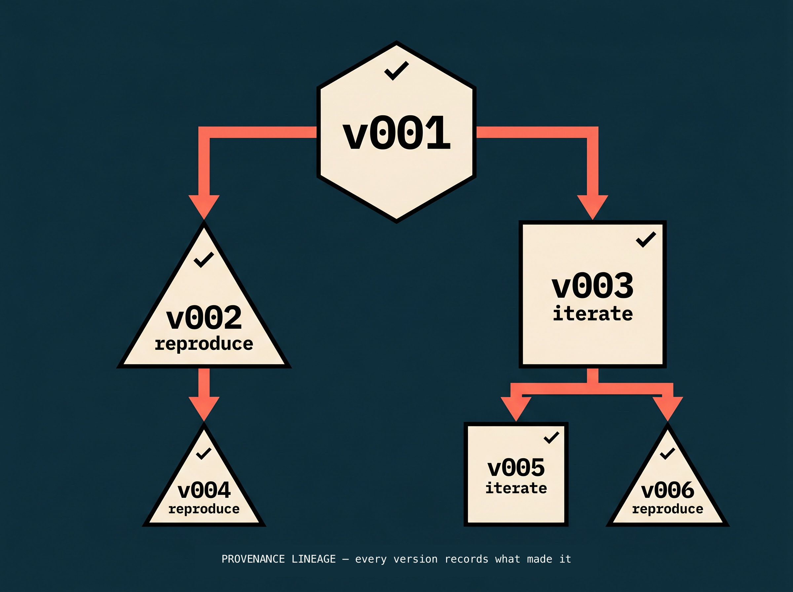
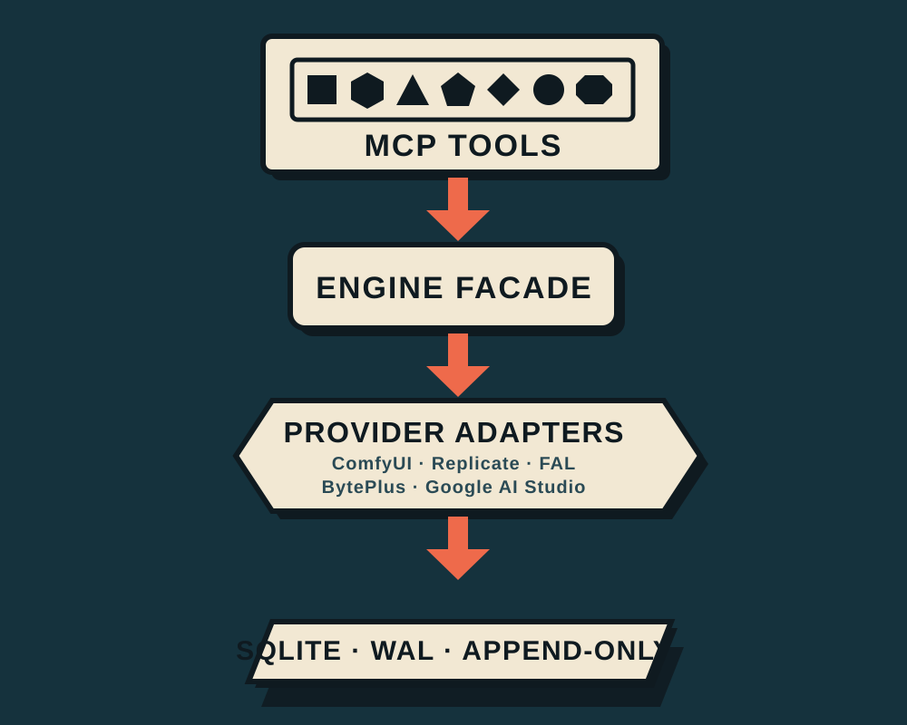

<p align="center">
  
</p>

<h1 align="center">Vellum</h1>

<p align="center">
  <strong>Provider-agnostic production tracking + provenance for AI asset generation, surfaced as MCP tools.</strong><br/>
  <em>Workspace → project → sequence → shot → version. Append-only provenance. An approval gate in front of paid calls. Replay what Vellum submitted — byte-identical for ComfyUI graphs, parameter replay elsewhere.</em>
</p>

<p align="center">
  <a href="#license"></a>
  
  
  
  
</p>

---

## Why this exists

AI asset generation never stays in one tool. A production pulls from ComfyUI, Replicate, FAL, and a rotating cast of model APIs — and the moment it does, tracking breaks down. Files spill across services, seeds get lost, model versions drift, credits get spent on runs nobody approved, and *"which prompt made this frame?"* becomes a slow manual hunt through files and logs.

Vellum is the neutral layer between any generator and any downstream workflow. It gives a production the structure it needs — project, sequence, shot, version, immutable provenance, and lineage you can diff and reproduce — and an opt-in gate that puts a human approval in front of every paid call, whichever backend produces the pixels.

## What it does

Vellum is an [MCP](https://modelcontextprotocol.io) server that exposes seven coarse-grained tools (under the 12-tool MCP cap), runs over **stdio** and **Streamable HTTP** at once, and ships with a Preact dashboard served from the same process. Any MCP client — Claude Desktop, Claude Code, Cursor, MCP Inspector — gets the same surface and can learn it cold from the self-describing `vellum://capabilities` and `vellum://output-contract` resources.

A generation flows **outbound** (submit and poll any configured provider) or **inbound** (an agent or provider webhook registers a finished asset by URL). Either way it lands as an immutable, versioned record you can diff and trace — and, for takes Vellum itself submitted, reproduce (byte-identical for ComfyUI graphs, parameter replay elsewhere) or iterate from (graph surgery, so it needs a ComfyUI-produced source); externally-registered takes carry diff + provenance only. When the approval gate is on, none of it spends credits until a human signs off.

### The seven tools

| Tool         | Purpose                                                              | Actions                                                                 |
| ------------ | ------------------------------------------------------------------- | ---------------------------------------------------------------------- |
| `workspace`  | Top-level container (a show, a client, a project group)             | `create`, `list`, `get`, `rename`, `archive`, `unarchive`, `history`   |
| `project`    | A film, episode, spot, or campaign; carries an output-naming template and a versioned spec | `create`, `list`, `get`, `rename`, `archive`, `unarchive`, `history`, `set_naming_template`, `set_spec`, `get_spec`, `list_spec_revisions` |
| `sequence`   | A scene or shot group within a project                              | `create`, `list`, `get`, `rename`, `archive`, `unarchive`, `history`   |
| `shot`       | An individual shot — status lifecycle + a generated pipeline log     | `create`, `list`, `get`, `rename`, `archive`, `unarchive`, `history`, `set_status`, `get_status`, `list_status_history`, `pipeline_log` |
| `generation` | Submit/poll any provider; reproduce/iterate; register an external output; or run the **approval gate** (including for actions Vellum doesn't execute) | `submit`, `status`, `reproduce`, `iterate`, `register`, `propose`, `approve`, `reject`, `list_proposals`, `record_cost` |
| `version`    | Read versions, full provenance, structured diffs, and C2PA manifests | `get`, `list`, `provenance`, `diff`, `export_manifest`, `verify_manifest`, `redact_manifest` |
| `asset`      | Tag versions, attach metadata, and query across the hierarchy       | `add_tag`, `remove_tag`, `set_metadata`, `remove_metadata`, `query`, `list_tags`, `list_metadata_keys` |

Every response carries the full hierarchy breadcrumb (`workspace > project > sequence > shot`), every input is Zod-validated, every error is human-readable with an actionable next step, and every list is paginated (default page size 20).

**Naming is yours.** Shot names take whatever your studio uses — `sh010`, `SH014`, `EP101_SH014`, `SC012_SH0030`. The only rules are safety ones, because the name becomes a directory: no spaces, no `..`, no leading dot, not a Windows reserved device name.

**Nothing is create-only, and nothing is deletable.** `rename` fixes a wrong name; `archive`/`unarchive` takes a sequence out of the cut without destroying it. Both are recorded in an append-only history (`history` returns the transitions plus every name the entity has had), so an old filename or pipeline log stays traceable to the current row. Archived entities leave list results *and* their counts, refuse new work, and stay readable — pass `include_archived: true` to see them. There is no delete at any level: provenance points at these ids, and a record whose subject can vanish is not a record. Renaming does **not** move files already on disk; output paths are stored per version, so earlier takes stay resolvable where they were written.

Most lists are offset-paginated and return `{ items, total_count, limit, offset }`.
`version list` is **cursor**-paginated: it returns `next_cursor` alongside those
fields, and passing a non-zero `offset` is an error rather than a silent no-op —
read `next_cursor` and pass it back as `cursor`. The `vellum://output-contract`
resource states this too, so an agent can learn it without reading this file.

## Providers

Five backends ship today behind one `GenerationProvider` interface, across three response shapes (graph, URL-poll, inline-base64). Adding one is a single class plus a registry entry — the engine never changes.

| Provider           | Response shape        | Credential env                          |
| ------------------ | --------------------- | --------------------------------------- |
| **ComfyUI Cloud**  | graph (workflow JSON) | `COMFYUI_API_KEY`                       |
| **Replicate**      | URL poll              | `REPLICATE_API_TOKEN`                   |
| **FAL**            | URL queue             | `FAL_KEY`                               |
| **BytePlus / ModelArk** | async task       | `BYTEPLUS_API_KEY`                      |
| **Google AI Studio** (Gemini / Nano Banana) | inline base64 | `GOOGLE_AI_STUDIO_API_KEY` / `GEMINI_API_KEY` |

Vellum discovers whichever credentials are present and constructs every configured backend. `generation submit` takes an optional `provider`; status, reproduce, and download route to the provider that produced each version. SSRF-safe redirect gates, host allowlists, size caps, and idle-timeout streaming downloads apply to every URL backend.

## The approval gate — no silent credit spend

The gate is **off by default** — `submit` / `reproduce` / `iterate` spend directly until you turn it on. Set `VELLUM_REQUIRE_APPROVAL=1` and they stop. Instead:

1. `generation propose` records the **full, verbatim request** and a caller-supplied cost estimate — before any provider is touched.
2. A human reads the proposal (in the dashboard inbox or via `list_proposals`) and `approve`s or `reject`s it.
3. Approval executes exactly once — a guarded claim on the proposal row makes double-spend structurally impossible.

Actual spend is recorded back with `record_cost`, so each shot's log shows estimate-vs-actual and a running total. Nothing hits a paid API without a name on it.

**The same gate covers actions Vellum doesn't run.** Spend is the obvious thing to gate; irreversibility is the one that actually matters. An agent about to overwrite a scene file, relight a shot in a DCC, or publish to a tracker can `propose` with `kind: 'external'` — the verbatim action is recorded, a human approves it exactly once, and *nothing executes*. What you get is the missing artifact: a durable record that a named person authorized that exact action, in the same queue as your spend proposals. A free action can still be unrecoverable.

## Shot approval — what was approved, and is it still current

`shot set_status` accepts an `approved_version_id`, so an approval records *which* take was signed off rather than only that the shot was approved at some point. The pointer is validated against the shot and written both as a materialized field and into the append-only status history.

A new take **never silently un-approves** a shot — quietly reverting someone's sign-off because a file landed is worse than the problem it solves. Instead the staleness becomes visible: `get_status` derives `approvalStale` and `versionsSinceApproval` at read time (a cached flag would go stale the instant the next take arrived, which is the exact bug), and the pipeline log renders `**Approved take:** v001 — ⚠️ 2 newer takes since`. An approval that named no version says `_not recorded_` rather than implying it covers the latest.

## Project specs — versioned standing context

A project carries a **spec**: opaque text (a style bible, a look book, a palette-and-naming contract) that an agent reads *before* it generates. Vellum doesn't parse it. It versions it, hashes it, and stamps the active revision onto every version created afterwards as an append-only `spec_bound` provenance event.

```bash
project set_spec              # ALWAYS appends a revision — never edits in place
project get_spec              # latest, or a specific revision
project list_spec_revisions   # how the rules evolved
```

Agents fetch it by URI — `vellum://project/{project_id}/spec` — so they load the one project they're working in rather than one monolithic context file that grows with the show.

The point is the binding. When an output is wrong *because the spec was ambiguous*, you fix the **spec**, and earlier takes stay dated to the revision they were actually made under — visible per take in the pipeline log and in `version provenance`. That's what makes a pipeline improve over a hundred shots instead of accumulating a hundred hand-fixes. See **[docs/agent-context-patterns.md](docs/agent-context-patterns.md)**.

## Provenance — immutable by construction

<p align="center">
  
</p>

Every generation captures its full provenance:

- `workflow_json` / `prompt_json` — for graph backends (ComfyUI): the submitted workflow plus the **resolved** prompt with seeds and model paths baked in
- `generation_request_json` / `generation_result_json` — the neutral, provider-agnostic record (params, models, output hash) for URL and inline backends and for externally-registered outputs
- `provider`, `seed`, `model_names`, `timestamp`, lineage links, cost, and optional checksums + C2PA manifests

You can:

- **`version diff`** any two versions — including across provider families (a ComfyUI graph vs. a Replicate URL run) via a neutral params comparison
- **`generation reproduce`** any version Vellum itself submitted — replays the stored request (byte-identical for a ComfyUI resolved graph; parameter replay for URL backends, with an honest "not byte-identical" warning). Externally-registered takes are diff-and-provenance only
- **`generation iterate`** from any ComfyUI-produced version with scoped overrides and an optional new seed, tracking the parent — iterate is node-graph surgery, so params-based and externally-registered sources are out of scope
- **`version export_manifest` / `verify_manifest`** — signed C2PA manifests with AI-disclosure, an ingredient/lineage graph, and value redaction that preserves the *fact* of redaction

Provenance is **immutable by construction**. The `ProvenanceRepo` exposes only inserts and reads — no setters, no deletes. Prototype-assertion tests fail the build if anyone ever adds one.

## Production tooling

Everything below is generated **from** the append-only provenance — never a second source of truth to hand-maintain:

- **Per-shot pipeline log** (`shot pipeline_log`) — status timeline, every take with provider/lineage/cost/outputs, and any gated calls that produced no take (rejected / pending / approved-but-failed), so nothing spent goes unlogged
- **Output naming** — a per-project Hybrid-v1 template (`{project}_{sequence}_{shot}_…`) applied at persist time, so files land as `DEMO01_SEQ010_SH010_v003.png` instead of `gemini_0.png`
- **Palette QC** (`scripts/palette-qc.mts`) — checks a scene's sampled colors against a reference palette within a per-channel tolerance and writes a hex-sheet report
- **Training reports** (`scripts/training-report.mts`) — maps a Modal fine-tune run onto the hierarchy (effort → project, run → sequence, eval prompt → shot, checkpoint → version) so training progression reads like a shot history
- **Scene seeding** (`scripts/mirror-scene.mts`) — mirrors an existing folder of approved renders into Vellum under provenance tracking without regenerating anything ([quickstart](docs/quickstart.md))

## Dashboard

The same process serves a Preact + Tailwind dashboard (built into `dist/`, no dev server needed):

- a shot status view per sequence, with provider badges on each version
- the **approvals inbox** — the pending-spend queue, with live counts and one-click approve/reject over the proposal REST
- per-shot **pipeline logs** rendered inline, showing cost estimate-vs-actual and recorded spend
- provenance drill-down and an active-generations panel that updates over SSE as jobs move `submitted → running → completed`

## Architecture

<p align="center">
  
</p>

Four layers, each independently testable:

- **MCP tools** (`src/tools/*-tool.ts`) — thin Zod-validated entry points. Discriminated unions on `action`. Zero business logic.
- **Engine facade** (`src/engine/`) — pure TypeScript, **zero MCP dependency**. Architecture-purity tests enforce this boundary at the type level on every commit.
- **Provider adapters** (`src/providers/`, `src/comfyui/`) — every backend implements one `GenerationProvider` interface. The security-critical URL logic (recursive output extraction, SSRF-guarded streaming download) is shared, not duplicated.
- **SQLite + WAL** (`drizzle/`) — Drizzle ORM, twelve hand-prefixed migrations, `busy_timeout=5000`. Append-only provenance is *structurally* enforced — the repo has no `update` or `delete` path to the truth.

## Quickstart

### 1. Install

```bash
git clone https://github.com/alvdansen/vellum.git
cd vellum
npm install
```

Node 20.9–25 required — `better-sqlite3` is a native module and has no prebuilt binary for Node 26 yet, so it compiles from source and needs a C++ toolchain. The SQLite database (`vellum.db`) auto-creates on first start.

### 2. Configure a provider (optional)

```bash
cp .env.example .env
# Set any of: COMFYUI_API_KEY, REPLICATE_API_TOKEN, FAL_KEY,
#             BYTEPLUS_API_KEY, GOOGLE_AI_STUDIO_API_KEY
# Gate every paid call behind human approval:  VELLUM_REQUIRE_APPROVAL=1
```

Hierarchy, provenance, and `generation register` (inbound) work with **no** provider credentials at all — so you can try the whole structure-and-provenance surface before wiring a backend.

### 3. Smoke test (~5 seconds, no human watching)

```bash
npm run smoke
```

Drives the live MCP SDK client (`scripts/inspector-smoke.mjs`) through **30 wire-level assertions over BOTH transports — stdio and Streamable HTTP — 60 checks in all** — full hierarchy walk, breadcrumbs at every level, error envelopes, shot-name validation in both directions, pagination, get-by-id round-trips. Green here means the entire MCP transport + tool registration + engine wiring works end-to-end.

### 4. Full test suite

```bash
npm test                              # server suite — 2576 tests
cd packages/dashboard && npx vitest run   # dashboard suite — 544 tests
```

The suite covers hierarchy create/read/rename/archive (there is no delete, anywhere), provider SSRF guards, append-only provenance invariants, the approval gate (no double-spend), cross-provider reproduce + diff, asset query composition, the dashboard signal store, and SSE wire-shape. `architecture-purity.test.ts` is a cross-cutting guard: no MCP imports outside `src/tools/`, no engine-layer Zod, no test-only sentinels in production code.

### 5. Live, with the dashboard

```bash
# Terminal 1 — HTTP server (also serves the dashboard)
npm run start:http
open http://localhost:3000

# Terminal 2 — drive it with the MCP Inspector
npm run inspect
```

Create workspace → project → sequence → shot, submit a `generation`, and watch the active-generations panel update over SSE as the job runs. When it finishes, a version card appears with full provenance drill-down.

## Connecting an MCP client

### Claude Code

```bash
claude mcp add vellum --scope user -- bash -c "cd $(pwd) && exec npx -y tsx src/server.ts"
```

Then `/mcp` lists the seven tools — or just ask: *"create a workspace called 'demo' using vellum."*

### Claude Desktop

Add to `claude_desktop_config.json`:

```json
{
  "mcpServers": {
    "vellum": {
      "command": "npx",
      "args": ["-y", "tsx", "/absolute/path/to/vellum/src/server.ts"],
      "env": {
        "VELLUM_DB_PATH": "/absolute/path/to/vellum/vellum.db",
        "VELLUM_OUTPUTS_DIR": "/absolute/path/to/vellum/outputs"
      }
    }
  }
}
```

The server resolves its migrations, database, outputs root and dashboard against
its own location, so it starts from whatever working directory the client
chooses. Both env vars are optional and shown here because it is worth being
explicit about where a client writes when you run more than one.

### Streamable HTTP (web agents, custom clients)

```bash
npm run start:http
```

The MCP endpoint is `POST http://127.0.0.1:3000/mcp` (loopback only — the bind is hardcoded to 127.0.0.1 with no override). Dashboard, REST API, and SSE share the same Hono app — one port, no separate dev server.

## Project structure

```
vellum/
├── src/
│   ├── server.ts              # dual-transport entry point (stdio + Streamable HTTP)
│   ├── tools/                 # 7 MCP tools — Zod-validated, thin
│   ├── engine/                # pure-TS facade, zero MCP dependency
│   ├── providers/             # GenerationProvider adapters (Replicate, FAL, BytePlus, Google AI Studio)
│   ├── comfyui/               # ComfyUI Cloud client (SSRF-safe, healthchecked)
│   ├── http/                  # Hono REST routes + SSE + webhook ingest + error middleware
│   ├── store/                 # Drizzle repos — the only SQL in the codebase
│   ├── utils/                 # outbound guards, config parsing, atomic writes
│   └── __tests__/             # cross-cutting invariants (architecture purity, tool budget)
├── packages/
│   └── dashboard/             # Preact + Tailwind v4 + signals; built into dist/
├── drizzle/                   # SQLite migrations (12, hand-prefixed)
├── scripts/                   # smoke test, scene seed, palette QC, training report
├── SECURITY.md                # trust boundaries, outbound controls, known advisories
└── docs/                      # quickstart, diagrams, ingest guide, agent context patterns
```

## Roadmap

### v1.0 — MVP *(shipped)*
Hierarchy, async ComfyUI generation, append-only provenance with reproduce/iterate lineage, asset tagging and query, Preact dashboard, dual-transport MCP server.

### v2.0 — Provider-agnostic *(shipped)*
Decoupled from any single backend and rebranded to **Vellum**. Five adapters behind one seam; multi-provider routing; cross-provider reproduce and cross-family diff over neutral provenance; inbound `register` + bearer-gated webhook ingest; self-describing MCP resources; C2PA signing, verification, ingredient graph, and redaction; the approval gate; per-shot pipeline logs; cost tracking; output-naming templates; palette QC; and training reports.

### v2.1 — Agent context + a mutable hierarchy *(shipped)*
Versioned **project specs** served as a per-project MCP resource, with the active revision stamped onto every version at creation — so a wrong output traced to an ambiguous spec is fixed at the spec, and earlier takes stay dated to the revision they were made under. The approval gate generalized from spend to **irreversibility** (`propose kind: 'external'` authorizes an action Vellum does not run). Shot names opened up to real studio codes. **Rename and archive** at every level, with an append-only hierarchy history; still no delete anywhere. Shot approval records **which version** was approved and reports staleness when newer takes land.

### Next
- **Function-calling adapter** — an OpenAI-compatible REST endpoint for non-MCP agents
- **Batch operations** — shot queuing, hierarchy export, lineage-graph visualization in the dashboard
- **Regulator-facing provenance** — hardening the C2PA path against EU AI Act Article 50 (applies from 2 Aug 2026) and the California AI Transparency Act (SB 942 as amended by AB 853 — operative 2 Aug 2026)

## License

Vellum is **dual-licensed**: open source under **[AGPL-3.0](LICENSE)**, with a **commercial license** available for closed-source, proprietary, or hosted/SaaS use that the AGPL's copyleft would otherwise cover — see **[COMMERCIAL-LICENSE.md](COMMERCIAL-LICENSE.md)**. Commercial licenses are offered through [promptcrafted.com](https://promptcrafted.com). Copyright © 2026 Alvdansen Labs.

## Author

Designed and built by **Timothy** — independent AI Architect at **[promptcrafted.com](https://promptcrafted.com)**. Vellum is a working demo of the tooling I build for teams putting AI into production pipelines: real providers, provenance, and approval guardrails, shipped end-to-end.

## Acknowledgments

- **[ComfyUI](https://www.comfy.org)** — for the extensible generative-pipeline software this builds on, and its Cloud API
- **[Anthropic](https://www.anthropic.com)** and the **[Model Context Protocol](https://modelcontextprotocol.io)** — for the open protocol that makes this server portable across clients
- **[Alvdansen Labs](https://github.com/alvdansen)** — for hosting the release
